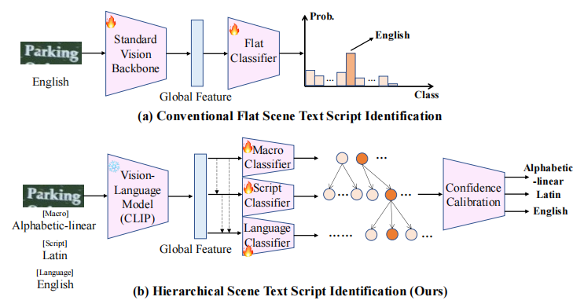
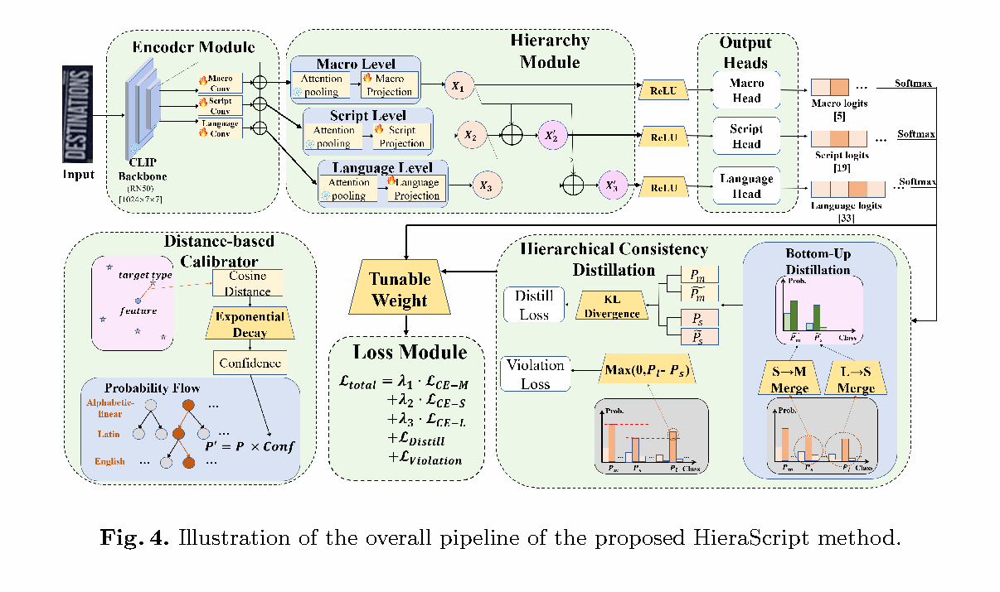
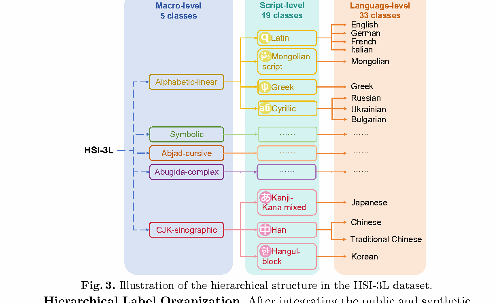
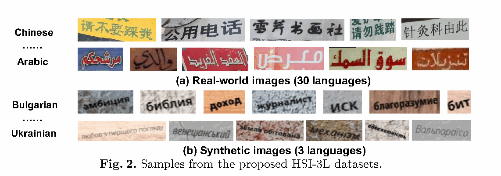

# HieraScript: Hierarchical Scene Text Script Identification via Parameter-Efficient Vision-Language Learning

[English](README.en.md) | [简体中文](README.md)

[-2f6fb0)](#citation)
[](#release-status)
[](#release-status)
[](#)
[](https://github.com/anhao77)

> **Release status.** The paper is camera-ready and the official **code + dataset release is in preparation**.
> The official repository will be published at **[billqxg/HieraScript](https://github.com/billqxg/HieraScript)**.
> **This page is a project showcase only - no source code or dataset is distributed here.**

Scene text script identification is the task of predicting *which writing system* a text instance in a natural
scene image belongs to. Existing methods treat it as a **flat** classification problem and rely on **full-model
fine-tuning** of vision-language models. We observe that scripts are naturally **hierarchical** (Macro ->
Script -> Language) and propose **HieraScript**, a hierarchical vision-language framework that combines
parameter-efficient transfer learning with hierarchical semantic modeling.



*(a) Conventional flat script identification with full-model fine-tuning. (b) The proposed hierarchical
formulation with a frozen vision-language backbone, hierarchy-specific classifiers, and confidence calibration.*

## Highlights

- **HSI-3L benchmark.** A multilingual scene text script identification dataset with **explicit three-level hierarchical annotations**, covering **33 languages**, **5 Macro classes**, **19 Script classes**, and **33 Language classes**, for a total of **472,087 images**.
- **HieraScript framework.** Built on a frozen CLIP backbone, it introduces a **Semi-Decoupled Hierarchical Representation** that models fine-grained glyph characteristics and hierarchical semantics jointly, while tuning only a small fraction of parameters.
- **Hierarchical consistency + calibration.** Hierarchical Consistency Constraints (consistency distillation and a hierarchy violation penalty) enforce agreement across levels during training, and a **Distance-based Calibrator** estimates prediction reliability at inference time.
- **Strong and transferable results.** HieraScript outperforms flat CLIP-based baselines (CLIP zero-shot,
  CLIP full-tuning, CoOp, PromptSRC) and is competitive with or better than specialized script identification methods, including under cross-domain evaluation.

## Method Overview



HieraScript consists of four components:

1. **Frozen CLIP visual encoder** - the pre-trained backbone (ResNet-50 variant by default) stays frozen,
   providing parameter-efficient feature extraction.
2. **Semi-Decoupled Hierarchical Representation** - three hierarchy-specific convolutional branches produce level-specific features, and child representations inherit ancestor information through nested feature fusion .
3. **Hierarchical Consistency Constraints** - language-level predictions are projected to the Script and Macro levels as soft targets (hierarchical consistency distillation), and a hierarchy violation penalty prevents a child node from being more confident than its parent. Adaptive loss balancing and uncertainty-based weighting stabilize the multi-level objectives.
4. **Distance-based Confidence Calibration** - prototypes estimated from correctly classified training samples calibrate the confidence of ambiguous or degraded inputs at inference time.

## HSI-3L Dataset



| Property | Value |
| --- | --- |
| Languages | 33 |
| Macro / Script / Language classes | 5 / 19 / 33 |
| Total images | 472,087 |
| Training / testing split | 350,205 / 121,882 |
| Real-world / synthetic | 30 languages (real) + 3 languages (synthetic: Bulgarian, Persian, Ukrainian) |

Real-world images are aggregated from existing public multilingual text benchmarks: CVSI, SIW-13, MLe2e,
MLT2017, KhmerST, Indic Scene Text on the Roadside, Bharat Scene Text Dataset, and the TC-STR 7k-word
Dataset. Low-resource languages are supplemented with synthetic samples generated by an open-source text
generator. All samples are uniformly mapped into the three-level label space, and evaluation reports Top-1
accuracy at the Macro (M-Acc), Script (S-Acc) and Language (L-Acc) levels, plus a hierarchical F1 (H-F1) score.



## Results

### Comparison with flat CLIP-based methods and different backbones

| Method | Backbone | Total (M) | Tunable (M) | CVSI | MLe2e | SIW-13 | MLT | HSI-3L (L-Acc) |
| --- | --- | --- | --- | --- | --- | --- | --- | --- |
| CLIP Zero-shot | RN50 | 102.01 | 0 | 46.76 | 70.02 | 54.50 | 39.87 | 20.71 |
| CLIP Full-tuning | RN50 | 102.01 | 102.01 | 69.70 | 95.63 | 89.31 | 71.90 | 88.20 |
| CoOp | RN50 | 76.72 | 0.01 | 57.90 | 95.20 | 69.00 | 62.10 | 58.60 |
| PromptSRC | RN50 | 115.05 | 0.02 | 50.20 | 75.10 | 49.60 | 47.10 | 44.10 |
| **HieraScript (ours)** | RN50 | 72.19 | 33.87 | 98.19 | 95.78 | 97.64 | 72.08 | **91.03** |
| **HieraScript (ours)** | RN50x4 | 128.29 | 41.15 | 98.30 | 95.78 | 97.69 | 73.22 | 91.61 |
| **HieraScript (ours)** | RN50x16 | 216.54 | 49.21 | 98.93 | 94.51 | 96.62 | 77.16 | 92.11 |
| **HieraScript (ours)** | ViT-B/16 | 186.98 | 17.75 | 98.09 | 98.52 | 96.45 | 72.69 | 90.71 |
| **HieraScript (ours)** | ViT-B/32 | 188.52 | 15.64 | **99.28** | 98.84 | 97.95 | 73.04 | 89.68 |

### Comparison with traditional script identification methods

| Method | CVSI | MLe2e | SIW-13 |
| --- | --- | --- | --- |
| Shi et al. | 94.30 | - | 89.40 |
| Gomez et al. | 97.20 | 94.40 | 94.80 |
| Cheng et al. | 98.60 | - | 96.50 |
| Ma et al. | 98.78 | 97.20 | 97.30 |
| Dutta et al. | 98.97 | 95.01 | 95.70 |
| Mahajan et al. | 97.40 | - | - |
| Guo et al. | 93.50 | 98.74 | - |
| FAS-Res2Net | 96.00 | - | 94.70 |
| SANet | 99.03 | - | 96.18 |
| Split-Net | 99.05 | 98.85 | 97.91 |
| BLCT-sum | 97.03 | 96.10 | 92.83 |
| **HieraScript (ours)** | **99.28** | 98.84 | **97.95** |

### Ablation (HSI-3L)

| Variant | H-F1 | M-Acc | S-Acc | L-Acc |
| --- | --- | --- | --- | --- |
| Baseline | 96.31 | 98.72 | 96.23 | 90.25 |
| + Hierarchical consistency losses | 96.46 | 98.73 | 96.28 | 90.41 |
| + Adaptive loss balancing | 96.55 | 98.73 | 96.53 | 90.92 |
| + Distance-based confidence calibration | 96.39 | 98.72 | 96.37 | 90.45 |
| + Text encoder | 96.04 | 98.47 | 95.88 | 89.78 |
| Full model (w/o feature fusion) | 96.51 | 98.88 | 96.60 | 90.53 |
| **Full model** | **96.66** | **98.92** | **96.68** | **91.03** |


## Citation

If you find this work useful, please cite:

```bibtex
@inproceedings{qin2026hierascript,
  title     = {HieraScript: Hierarchical Scene Text Script Identification via
               Parameter-Efficient Vision-Language Learning},
  author    = {Xugong Qin, Li Ling, Xulin Zhu, Zhicong Yu, Junhao Chen, Xinran Zhang, Yuanyuan Wang, and  Gangyan Zeng},
  booktitle = {Pattern Recognition and Computer Vision (PRCV)},
  year      = {2026},
  note      = {To appear}
}
```

## Authors and Affiliations

Xugong Qin, Li Ling, Xulin Zhu, Zhicong Yu, Junhao Chen, Xinran Zhang, Yuanyuan Wang, and Gangyan Zeng

School of Cyber Science and Engineering, Nanjing University of Science and Technology, Nanjing, China


## Acknowledgements

This work is funded by the Basic Research Program of Jiangsu (BK20251441, BK20251414) and the Jiangsu
Undergraduate Training Program for Innovation and Entrepreneurship (S202510288013).

## Contact

For questions about the paper, please contact the corresponding authors
Xugong Qin （[@billqxg](https://github.com/billqxg)）. This project page is maintained by Zhicong Yu ([@anhao77](https://github.com/anhao77)), co-first author.
